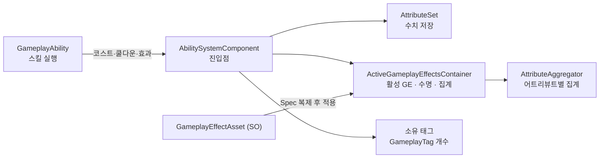

# AbilitySystem-For-Unity

Unreal Engine 5의 Gameplay Ability System(GAS)을 참고해 필요한 부분만 Unity에 다시 구현한 어빌리티 시스템과, 그것으로 만든 연습 모드 데모다. 라이브러리를 그대로 옮긴 게 아니라, GAS에서 필요한 개념만 골라 직접 구현했다.

> 🚧 **개발 중 (WIP)** — 수치·이펙트·태그·어빌리티 계층이 동작하고, 연습 모드 데모 씬에서 확인할 수 있다. 남은 GAS 기능(Gameplay Cue·AbilityTask·SetByCaller 등)은 아래 [시스템](#시스템) 표.

## 구조

모든 수치 변경은 **GameplayEffect(GE)** 하나를 거친다. 어빌리티(GA)도 코스트·쿨다운·효과를 모두 GE로 건다.
GE·GA는 ScriptableObject로 정의하고, 적용·부여할 때 런타임 인스턴스로 복제된다.



값은 두 가지로 나뉜다.

- **BaseValue** — 데미지·힐처럼 영구적으로 바뀌는 값.
- **CurrentValue** — 버프·장비처럼 활성 mod를 모아 계산하는 값. 효과가 빠지면 원래대로 돌아간다.

다른 어트리뷰트를 참조하는 값(예: 방어력 = 힘의 10%)은 참조 대상이 바뀌면 자동으로 다시 계산되고, 태그로 GE 적용·유지·어빌리티 발동을 조건부로 건다.

## 시스템

각 시스템의 개념·구조·UE 대비는 문서에서 다룬다. 전체 인덱스는 [아키텍처 개요](dev-docs/project/architecture/ability-system/overview.md).

| 시스템 | 상태 | 요약 | 문서 |
|---|---|---|---|
| Attribute | ✅ 구현 | 타입드 `AttributeSet` + 런타임 핸들(FieldInfo 캐싱), 초기 스탯 GE, 값 변경 훅 6종 | [attribute](dev-docs/project/architecture/ability-system/attribute.md) |
| GameplayEffect | ✅ 구현 | SO 정의 / 런타임 Spec 분리, Modifier 6종·Instant/Duration/Infinite·주기 실행·Execution, GE Component, 스택(수 1), 질의·이벤트 | [gameplay-effect](dev-docs/project/architecture/ability-system/gameplay-effect.md) |
| Aggregator | ✅ 구현 | 어트리뷰트별 CurrentValue 집계 + 캡처 대상 변경 시 라이브 재평가 | [aggregator](dev-docs/project/architecture/ability-system/aggregator.md) |
| Capture | ✅ 구현 | Source/Target·snapshot 어트리뷰트 캡처 (AttributeBased·Execution이 소비) | [capture](dev-docs/project/architecture/ability-system/capture.md) |
| GameplayTag | ✅ 구현 | 계층 태그·컨테이너·질의, ASC 소유 태그(개수), GE 태그 연동, 태그 피커·관리 창·Query 편집기 | [gameplay-tag](dev-docs/project/architecture/ability-system/gameplay-tag.md) |
| GameplayAbility | ✅ 구현 | 생명주기·인스턴싱·코스트/쿨다운/커밋·태그 차단/취소·입력·이벤트 | [gameplay-ability](dev-docs/project/architecture/ability-system/gameplay-ability.md) |

**📋 계획:** GameplayCue · AbilityTask · GameplayEvent · SetByCaller · ScalableFloat 커브 · GE 스택 수 2 이상 등.

**범위 밖:** GAS의 Replication(네트워크 복제)·예측(Prediction)은 구현에서 제외한다.

## 데모 — 연습 모드

`Assets/Scenes/Demo_PracticeMode.unity`. 허수아비를 상대로 어빌리티·GE·태그가 실제로 어떻게 맞물리는지 보는 씬이다 — 공격·조준·달리기·점프·대시, 마나를 쓰는 관통 파동 스킬, 회복·마나·강화·실드 아이템, 화염 존, 반격하는 허수아비와 실드 허수아비, 헤드샷.

| 입력 | 동작 |
|---|---|
| WASD · 마우스 | 이동 · 시점 |
| 마우스 왼쪽 | 공격 |
| 마우스 오른쪽 (누르는 동안) | 조준 |
| Left Shift (누르는 동안) | 달리기 |
| Space | 점프 |
| E | 관통 파동 스킬 (마나 사용) |
| F | 대시 |
| F1 | GAS 디버그 오버레이 (끔 → 간단 → 상세) |
| Esc | 설정 메뉴 |
| F11 | 전체 화면 |

에디터에서는 플레이어·허수아비를 선택하면 ASC 인스펙터에 어트리뷰트·활성 GE·어빌리티·소유 태그가 실시간으로 나온다(`Window ▸ Ability System ▸ ASC Inspector`로 별도 창도 열 수 있다).

> ⚠ 맵·VFX·일부 애니메이션에 쓴 스토어 에셋(Sci Fi Arena 3 · Opsive · UNI VFX · Vefects · Small Props Pack)은 재배포할 수 없어 저장소에 없다(`Assets/Art/Third Party/`). 클론해서 열면 그 참조가 빈 채로 보이지만, 어빌리티 시스템과 데모 로직은 그대로 동작한다.

## 요구 사항

- **Unity 6000.3.12f1** (Unity 6.3). 주요 패키지(URP 17.3, Visual Effect Graph 17.3, New Input System 1.19, Cinemachine 2.10, UniTask · R3, AI Navigation 2.0)는 프로젝트 매니페스트에서 자동 복원된다.

## 실행

```bash
git clone https://github.com/hanaaple/AbilitySystem-For-Unity.git
```

Unity Hub에서 위 버전으로 프로젝트를 열고(패키지 자동 복원) `Assets/Scenes/Demo_PracticeMode.unity`를 Play 한다.

- 어빌리티 시스템 코드 — `Assets/Scripts/Core/AbilitySystem/`
- 데모 게임 코드 — `Assets/Scripts/Game/`
- 데모 GA·GE 데이터 — `Assets/Data/Demo/`
- 셀프체크 — 메뉴 `Tools ▸ Ability System ▸ Run … Self-Check` (`Assets/Scripts/Test/`)

## 참고

- Unreal Engine 5 Gameplay Ability System — 설계 참고 대상(이식이 아닌 개념 재구현).
- Lyra Starter Game — 게임 쪽 GAS 사용 방식(입력·피격 정보) 참고.

## 라이선스

현재 별도 오픈소스 라이선스를 두지 않았다.
