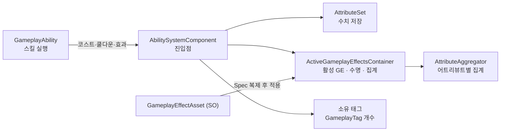

# AbilitySystem-For-Unity

Unreal Engine 5의 Gameplay Ability System(GAS)을 Unity로 다시 구현한 어빌리티 시스템과, 그걸로 만든 연습 모드 데모입니다.
라이브러리를 옮긴 게 아니라 GAS에서 필요한 개념만 골라 직접 구현했고, 네트워크 복제·예측처럼 로컬 게임에 필요 없는 부분은 뺐습니다.


좌우 패널은 F1로 켜는 디버그 오버레이입니다. 플레이어(왼쪽)와 십자선으로 겨눈 대상(오른쪽)의 어트리뷰트, 걸려 있는 GE, GA, 태그를 실시간으로 보여 줍니다.

아직 개발 중입니다. GameplayCue, AbilityTask, SetByCaller 등은 남아 있습니다.

- [데모](#데모)
- [시스템](#시스템)
- [구조](#구조)
- [실행](#실행)
- 문서: [데모](dev-docs/project/demo.md) · [아키텍처](dev-docs/project/architecture/ability-system/overview.md)

## 데모

`Assets/Scenes/Demo_PracticeMode.unity` — 허수아비를 상대로 GA·GE·태그가 어떻게 맞물리는지 보는 씬입니다.
기능별로 어떤 GA와 GE가 걸리는지는 [데모 문서](dev-docs/project/demo.md)에 정리해 두었습니다.

용어: GA는 스킬·행동, GE는 수치를 바꾸는 효과, 태그는 상태를 나타내는 이름표입니다.

<table>
  <tr>
    <td width="50%" valign="top">
      <br>
      <b>이동</b><br>
      달리기·조준·점프·구르기도 GA로 만들었습니다. 조준하면 달리기가 끊기는 건 GA의 태그 차단·취소 설정입니다.
    </td>
    <td width="50%" valign="top">
      <br>
      <b>일반 공격 / 헤드샷</b><br>
      맞으면 대상에게 피해 GE가 걸립니다. 머리에 맞으면 피해 계산에서 ×2가 됩니다.
    </td>
  </tr>
  <tr>
    <td width="50%" valign="top">
      <br>
      <b>관통 파동 (E)</b><br>
      파동 5개가 허수아비를 관통하고, 맞은 대상마다 피해 GE와 4초짜리 낙인 GE가 걸립니다. 낙인이 끝날 때 한 번 더 터집니다.
    </td>
    <td width="50%" valign="top">
      <br>
      <b>아이템</b><br>
      픽업은 GA를 실행하고, 수치는 그 GA가 거는 GE가 바꿉니다. 강화 중에는 패널에 attack 65 (base 50)처럼 원래 값이 같이 보입니다.
    </td>
  </tr>
  <tr>
    <td width="50%" valign="top">
      <br>
      <b>화염 구역</b><br>
      안에 있는 동안 화상 GE와 태그가 붙고, 화면 연출은 태그만 보고 켜집니다. 연습 모드라 체력은 1 아래로 내려가지 않습니다.
    </td>
    <td width="50%" valign="top">
      <br>
      <b>실드 / 공격 허수아비</b><br>
      피해는 실드부터 깎입니다. 공격 허수아비는 1초마다 정면으로 쏘고, 쿨다운도 GE로 돌아갑니다.
    </td>
  </tr>
</table>

### 조작

| 입력 | 동작 |
|---|---|
| WASD / 마우스 | 이동 / 시점 |
| 마우스 왼쪽 | 공격 |
| 마우스 오른쪽 (누르는 동안) | 조준 |
| Left Shift (누르는 동안) | 달리기 |
| Space | 점프 |
| E | 관통 파동 (마나 30) |
| F | 구르기 |
| F1 | 디버그 오버레이 (끔 → 간단 → 상세) |
| Esc | 설정 메뉴 |
| F11 | 전체 화면 |

에디터에서 플레이어나 허수아비를 선택하면 ASC 인스펙터에 같은 정보가 나옵니다. 별도 창은 `Window ▸ Ability System ▸ ASC Inspector`.

맵·VFX·일부 애니메이션에 쓴 스토어 에셋(Sci Fi Arena 3, Opsive, UNI VFX, Vefects, Small Props Pack)은 재배포할 수 없어서 저장소에 없습니다(`Assets/Art/Third Party/`). 클론하면 그 참조가 비어 보이지만 어빌리티 시스템과 데모 로직은 그대로 동작합니다.

## 시스템

각 시스템의 개념, 구조, UE와 다른 점은 [아키텍처 문서](dev-docs/project/architecture/ability-system/overview.md)에 있습니다.

| 시스템 | 내용 | 문서 |
|---|---|---|
| Attribute | 타입이 있는 `AttributeSet`, 런타임 핸들(FieldInfo 캐싱), 초기 스탯 GE, 값 변경 훅 6종 | [attribute](dev-docs/project/architecture/ability-system/attribute.md) |
| GameplayEffect | SO 정의와 런타임 Spec 분리, Modifier 6종, Instant/Duration/Infinite, 주기 실행, Execution, GE Component, 스택(수 1), 질의·이벤트 | [gameplay-effect](dev-docs/project/architecture/ability-system/gameplay-effect.md) |
| Aggregator | 어트리뷰트별 CurrentValue 집계, 참조하는 값이 바뀌면 다시 계산 | [aggregator](dev-docs/project/architecture/ability-system/aggregator.md) |
| Capture | Source/Target, snapshot 캡처 (AttributeBased·Execution에서 사용) | [capture](dev-docs/project/architecture/ability-system/capture.md) |
| GameplayTag | 계층 태그·컨테이너·질의, ASC 소유 태그(개수), GE 태그 연동, 태그 피커·관리 창·Query 편집기 | [gameplay-tag](dev-docs/project/architecture/ability-system/gameplay-tag.md) |
| GameplayAbility | 생명주기, 인스턴싱, 코스트·쿨다운·커밋, 태그 차단·취소, 입력, 이벤트 | [gameplay-ability](dev-docs/project/architecture/ability-system/gameplay-ability.md) |

남은 것: GameplayCue, AbilityTask, GameplayEvent, SetByCaller, ScalableFloat 커브, GE 스택 수 2 이상.
하지 않는 것: Replication(네트워크 복제), Prediction(예측).

## 구조

모든 수치 변경은 GameplayEffect(GE)를 거칩니다. GA도 코스트·쿨다운·효과를 전부 GE로 겁니다.
GE와 GA는 ScriptableObject로 정의하고, 적용·부여할 때 런타임 인스턴스로 복제됩니다.



값은 두 가지입니다. 데미지나 회복처럼 영구적으로 바뀌는 BaseValue, 버프처럼 걸려 있는 효과를 모아 계산하는 CurrentValue입니다. 효과가 빠지면 CurrentValue는 원래대로 돌아갑니다.
다른 어트리뷰트를 참조하는 값(예: 방어력 = 힘의 10%)은 참조 대상이 바뀌면 다시 계산되고, 태그로 GE 적용·유지나 GA 발동에 조건을 걸 수 있습니다.

## 실행

Unity 6000.3.12f1 (Unity 6.3)이 필요합니다. URP 17.3, Visual Effect Graph 17.3, Input System 1.19, Cinemachine 2.10, AI Navigation 2.0 등은 매니페스트에서 자동으로 받습니다.

```bash
git clone https://github.com/hanaaple/AbilitySystem-For-Unity.git
```

Unity Hub에서 프로젝트를 열고 `Assets/Scenes/Demo_PracticeMode.unity`를 Play 하면 됩니다.

| 경로 | 내용 |
|---|---|
| `Assets/Scripts/Core/AbilitySystem/` | 어빌리티 시스템 |
| `Assets/Scripts/Game/` | 데모 게임 코드 |
| `Assets/Data/Demo/` | 데모 GA·GE 데이터 |
| `Assets/Scripts/Test/` | 셀프체크(메뉴 `Tools ▸ Ability System ▸ Run … Self-Check`), PlayMode 테스트 |

## 참고

- Unreal Engine 5 Gameplay Ability System — 설계 참고 (이식이 아니라 개념을 다시 구현)
- Lyra Starter Game — 게임 쪽에서 GAS를 쓰는 방식(입력, 피격 정보) 참고

## 라이선스

아직 오픈소스 라이선스를 정하지 않았습니다.
