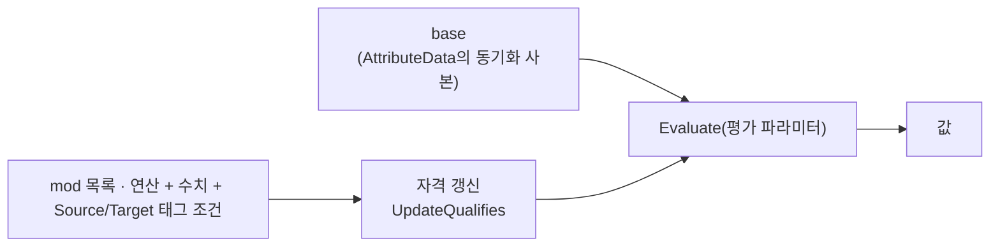
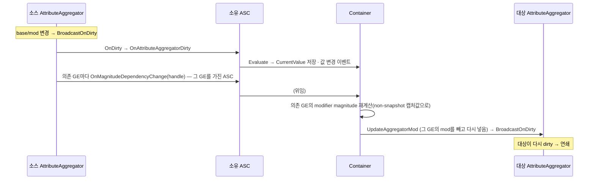

# AbilitySystem — Aggregator (어트리뷰트 반응성 / 라이브 재평가)

어트리뷰트별 CurrentValue 집계와, 캡처 대상이 바뀌면 의존 이펙트를 **즉시 재평가**하는 반응성 계층. UE `FAggregator`의 집계 + dirty/dependents 개념을 재구현한다. 상위 개요는 [overview](overview.md).

> UE 대비는 [overview §UE GAS 대비](overview.md#ue-gas-대비--채택생략).

## 무엇을 푸는가

두 가지를 한 객체가 맡는다.

1. **CurrentValue 집계** — 지속형 GE의 mod를 어트리뷰트별로 모아 공식으로 누산해 CurrentValue를 낸다.
2. **라이브 재평가** — "방어력 = 힘의 10%"처럼 다른 어트리뷰트를 캡처한(non-snapshot) magnitude가, **소스 어트리뷰트가 바뀌면 그 즉시** 재계산돼 따라간다. 이게 없으면 magnitude가 적용 시점에 고정돼 non-snapshot이 무력해진다.

## 집계 (Evaluate)



```
값 = ((Base + ΣAddBase) × (1 + Σ(MultiplyAdditive − 1)) / (1 + Σ(DivideAdditive − 1)) × ΠMultiplyCompound) + ΣAddFinal
```

- 자격 있는(태그 조건을 맞춘) mod만 들어간다. **Override**는 먼저 만난 자격 있는 Override가 최종값을 대신한다.
- 평가는 두 단계다 — 평가 파라미터의 Source·Target 태그로 모든 mod의 자격을 갱신하고(`UpdateQualifies`), 그다음 자격만 읽어 계산한다(UE와 같은 구조).
- **CurrentValue는 빈 평가 파라미터로** 계산한다 — 태그 조건이 있는 mod는 CurrentValue에 들어가지 않고, 다른 GE가 이 어트리뷰트를 캡처해 평가할 때 그 GE의 태그로 켜진다(UE와 같음). 소유 태그로 GE 전체를 켜고 끄는 일은 GE Component가 한다 → [gameplay-tag](gameplay-tag.md).

여기 담기는 mod는 **ASC에 걸린 지속형(period 0) 활성 GE의 modifier**다 — 컨테이너가 GE 적용·제거·억제 때 등록·해제한다. Modifier 정의와 연산은 → [gameplay-effect §Modifier](gameplay-effect.md#modifier).

## 소유 구도

- **어트리뷰트별 `AttributeAggregator`** — base 사본 + mod 목록 + 의존 GE 목록.
- **`ActiveGameplayEffectsContainer`가 소유** — 어트리뷰트별로 하나씩 **지연 생성**(캡처나 지속 mod가 실제로 필요할 때만).
- **base 진실은 `AttributeData`** — aggregator의 base는 동기화 사본이다. base 쓰기는 늘 `AttributeData`에 하고, aggregator가 있을 때만 사본을 맞춘다. aggregator가 없으면 Current = Base로 바로 쓴다. 모든 어트리뷰트에 aggregator를 만들지 않는 UE의 lazy 모델.
- **조회는 저장값** — aggregator가 계산한 값은 dirty마다 `AttributeData` Current에 저장되고(저장 직전 `PreAttributeChange` 클램프), `GetAttributeCurrentValue`는 그 저장값을 읽는다.

## 반응성 흐름 (라이브 재평가)

소스 어트리뷰트가 dirty해지면 두 갈래로 퍼진다 — ① 그 어트리뷰트의 CurrentValue 재계산, ② non-snapshot으로 이 값에 의존하는 GE들의 magnitude 재평가(연쇄).



- **의존 등록:** non-snapshot 캡처만 소스 aggregator에 "이 GE가 당신에게 의존한다"고 등록한다. snapshot은 캡처 시점을 복사·고정해 등록하지 않는다. (캡처 구조·시점 → [capture](capture.md))
- **ASC 경계를 넘는다:** 의존 GE 핸들은 자기 소유 ASC를 알아, 다른 ASC의 어트리뷰트를 캡처한 GE도 같은 흐름으로 따라간다. 의존 ASC가 파괴됐으면 목록에서 뺀다.
- **연쇄와 순환:** 재평가가 다른 어트리뷰트를 dirty시키면 연쇄된다. 자기참조(A→B→A) 순환은 전파 깊이 상한(`MaxBroadcastDirty`)으로 끊는다 — 수렴 보장이 아니라 폭주 차단이다.
- **값이 같아도 알림:** 재계산 결과가 같아도 값 변경 이벤트가 나간다(UE와 같음).

## 진입점 (Entry Points)

| 목적 | API | 위치 |
|---|---|---|
| 값 계산 | `AttributeAggregator.Evaluate(parameters)` | `Effect/AttributeAggregator.cs` |
| Base 직접 적용(영구) | `AttributeAggregator.ExecModOnBaseValue(base, op, mag)` (static) | 〃 |
| persistent mod 등록/해제/갱신 | `AddAggregatorMod` / `RemoveAggregatorMod` / `UpdateAggregatorMod` | 〃 |
| dirty 구독 | `OnDirty` (event) | 〃 |
| 의존자 등록/해제 | `AddDependent` / `RemoveDependent` | 〃 |
| snapshot 고정 | `TakeSnapshotOf(other)` | 〃 |
| non-snapshot 링크 등록/해제 | `GameplayEffectAttributeCaptureSpecContainer.Register/UnregisterLinkedAggregatorCallbacks(handle)` | `Effect/GameplayEffectAttributeCaptureSpecContainer.cs` |

## UE ↔ Unity 대응

| UE GAS | 이 프로젝트 | 대응 시 판단 / 차이 |
|---|---|---|
| `FAggregator` | `AttributeAggregator` | 어트리뷰트별 집계 + dirty/dependents 재구현 |
| `FAggregator.ModChannels[]` · `FAggregatorModChannelContainer` | flat `List<Mod>` (채널·컨테이너 없음) | → 아래 "채널·컨테이너" |
| `FAggregatorMod::UpdateQualifies` / `Qualifies` | 같은 두 단계 | 채택. 평가 파라미터는 Source·Target 태그만(필터·무시 핸들·예측 mod 없음) |
| dirty broadcast / dependents | `OnDirty` + 의존 GE 목록 | 채택. 순환은 깊이 상한으로 차단 |
| `FScopedAggregatorOnDirtyBatch` | (없음) | mod마다 OnDirty가 울린다 |
| snapshot / non-snapshot 캡처 | `GameplayEffectAttributeCaptureSpec` | 채택 → [capture](capture.md) |
| fixed-point 수렴 | (생략) | 깊이 상한까지만 |

## UE 대비 — 채널·컨테이너

UE `FAggregator`는 mod를 평가 채널(`EGameplayModEvaluationChannel`, Channel0~15)별로 나눠 담고, 채널들을 래퍼로 감싼다:

```
FAggregator
 ├ BaseValue
 └ FAggregatorModChannelContainer
     └ FAggregatorModChannel[]          ← 채널별
         └ 연산별 mod 배열 (Add / Multiply / Divide / Override)
```

이 프로젝트는 **평가 채널을 하나로 고정**한다 — 채널 축과 컨테이너 래퍼 없이 `AttributeAggregator`가 mod를 flat `List<Mod>`로 직접 소유하고, 평가할 때 연산별로 집계한다.

## 범위

- **대상:** 지속형(persistent) AttributeBased 모디파이어의 cross-attribute 라이브 재평가 — 같은 ASC든 다른 ASC든.
- **생략:** 자기참조 fixed-point 수렴, Execution 라이브 재평가(Execution은 Instant·Periodic 이벤트성이라 대상 아님), 평가 채널, dirty 배칭.
