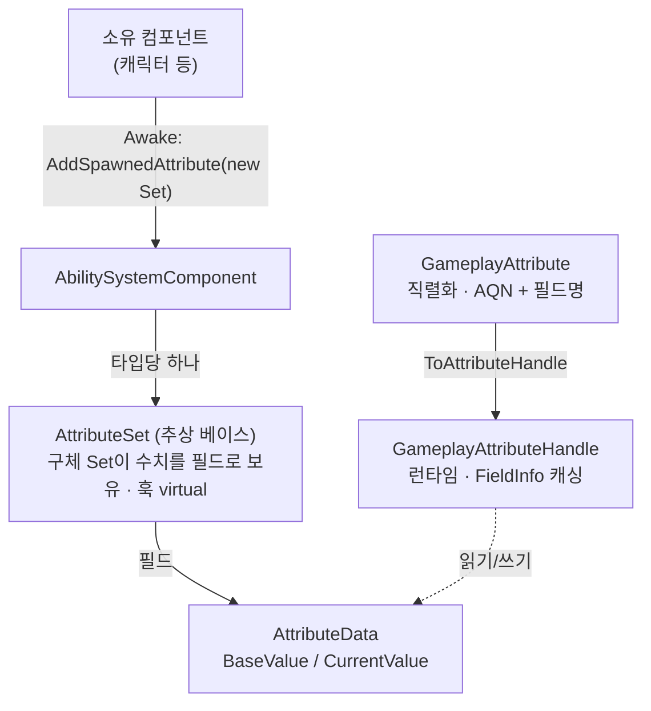
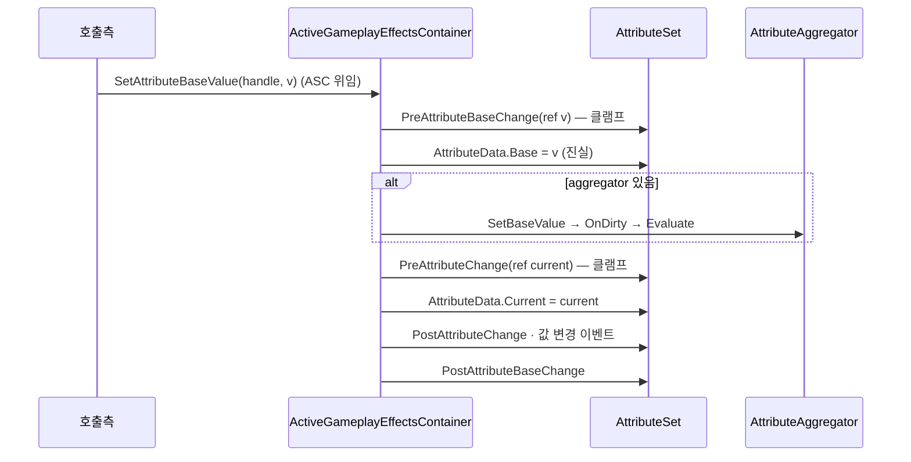

# AbilitySystem — Attribute

캐릭터 수치(체력·스태미나·이동속도 등)를 담고 읽고/쓰는 계층. 상위 개요는 [overview](overview.md).

> UE GAS의 `UAttributeSet`/`FGameplayAttribute`를 참고해 필요한 축만 재구현. **개념·방향** 중심 — 필드·선언 세부는 코드를 본다.

## 구조



- **`AttributeSet`** — 추상 베이스. 구체 Set이 값을 필드로 보유하고, ASC는 타입당 하나만 등록한다(도메인별로 필요한 Set만 붙이고, 필드가 컴파일타임에 존재해 오타·타입 오류를 막는다). 소유 ASC를 알고(등록 때 주입), 값 변경 훅을 `virtual`로 연다.
- **`AttributeData`** — 한 수치의 `BaseValue`/`CurrentValue` 쌍. Base는 영구값, Current는 보정 반영값.

두 종류의 어트리뷰트 참조가 나온다 — 코드에서 쓰는 런타임 `GameplayAttributeHandle`과 에셋에 저장되는 직렬화 `GameplayAttribute`.

## AttributeSet 만들기 — 작성 패턴

수치를 담을 구체 Set은 `AttributeSet`을 상속하고, 어트리뷰트마다 **두 가지를 짝지어** 선언한다 — 값을 담는 `AttributeData` 인스턴스 필드와, 그 필드를 밖에서 가리키는 `static readonly GameplayAttributeHandle`.

```csharp
public class CharacterAttributeSet : AttributeSet
{
    // (1) 실제 값 — 인스턴스 필드. 초기 스탯 GE가 채우고, 핸들이 읽고/쓴다.
    public AttributeData health;
    public AttributeData maxHealth;
    public AttributeData speed;

    // (2) 외부 식별용 정적 핸들 — 필드 하나당 하나. typeof + nameof로 필드에 묶는다.
    public static readonly GameplayAttributeHandle Health    = new(typeof(CharacterAttributeSet), nameof(health));
    public static readonly GameplayAttributeHandle MaxHealth = new(typeof(CharacterAttributeSet), nameof(maxHealth));
    public static readonly GameplayAttributeHandle Speed     = new(typeof(CharacterAttributeSet), nameof(speed));
}
```

- **값 필드(`AttributeData`)** — 실제 Base/Current를 든다. 캐릭터마다 값이 다르니 인스턴스에 있다.
- **정적 핸들(`GameplayAttributeHandle`)** — "이 Set의 이 어트리뷰트"를 코드에서 문자열 없이 가리키는 **이름표**. 값이 아니라 식별자라 타입당 하나면 충분해 `static readonly`. `typeof`+`nameof`로 Set·필드에 컴파일 타임에 묶어 오타·rename에 안전하다.

쓰는 쪽은 이 정적 핸들 하나로 값을 조회한다:

```csharp
float hp = asc.GetAttributeCurrentValue(CharacterAttributeSet.Health);
```

### UE의 매크로를 손으로 옮긴 것

UE GAS에선 어트리뷰트를 이렇게 선언한다:

```cpp
UPROPERTY() FGameplayAttributeData Health;    // 값
ATTRIBUTE_ACCESSORS(UMyAttributeSet, Health)  // 매크로가 접근자를 자동 생성
```

`ATTRIBUTE_ACCESSORS` 매크로가 `GetHealthAttribute()`(→ `FGameplayAttribute`) · `GetHealth()` · `SetHealth()` · `InitHealth()`를 **코드 생성**한다. 이 중 `GetHealthAttribute()`가 "밖에서 Health를 문자열 없이 가리키는 정적 진입점"이다.

C#엔 그런 코드 생성 매크로가 없다. 그래서 그 정적 접근자를 **손으로 하나 선언**한 게 `public static readonly GameplayAttributeHandle Health`다 — UE의 `GetHealthAttribute()`에 대응한다. `typeof`+`nameof` 바인딩으로 매크로가 주던 안전성(문자열 오타·rename 취약점 제거)을 매크로 없이 흉내 냈다.

> **대응 요약:** UE `FGameplayAttributeData Health`(값) + `GetHealthAttribute()`(정적 식별자) ↔ 여기 `AttributeData health`(값) + `static GameplayAttributeHandle Health`(정적 식별자).

## 참조 2분할 — 직렬화 vs 런타임

위 정적 핸들(`GameplayAttributeHandle`)은 **런타임 전용**이다 — `FieldInfo`를 들어 직렬화할 수 없다. 그래서 에셋·인스펙터가 어트리뷰트를 저장·저작하려면 문자열 형태의 짝이 하나 더 필요하고, 그게 `GameplayAttribute`다. (UE는 `FGameplayAttribute` 하나가 직렬화+런타임을 겸하지만, C#의 `FieldInfo` 직렬화 불가 제약상 둘로 나뉜다.)

- **`GameplayAttribute`(직렬화):** 타입명(AQN) + 필드명 문자열 쌍. 에셋 저작용 — GE modifier 대상, 캡처 대상 등.
- **`GameplayAttributeHandle`(런타임):** `GameplayAttribute.ToAttributeHandle()`로 문자열을 해석해 만든다. 값 동등성(`SetType`+`Name`)으로 Dictionary 키가 된다.

> **왜 FieldInfo 캐싱인가:** 핸들 생성 시 Reflection을 1회로 격리하면, 매 프레임 반복되는 값 읽기/쓰기(집계·재평가)에서 문자열 필드 탐색 비용이 사라진다. 비용을 "많이 호출되는 경로"에서 "한 번 만드는 경로"로 옮긴 선택이다.

## 초기화 — 소유 쪽이 Set을 만들고, 초기값은 GE로

Set은 소유 컴포넌트가 만들어 등록하고, 초기값은 **Instant GE의 Override 모디파이어**로 자기에게 건다. UE도 Owner 쪽 Set을 ASC가 모으고, 초기값을 GE로 주는 방식을 쓴다(ASC의 초기값 테이블은 테스트용 카테고리).

```csharp
// 소유 컴포넌트
[SerializeField] private GameplayEffectAsset defaultAttributes; // Instant · Override 모디파이어들

private void Awake()
{
    _asc.AddSpawnedAttribute(new CharacterAttributeSet());
}

// GE 컨테이너가 ASC Awake에서 만들어지므로 Start에서 적용한다
private void Start()
{
    _asc.ApplyGameplayEffectToSelf(defaultAttributes);
}
```

- 초기값이 GE 경로를 타므로 Set 훅(클램프)과 값 변경 이벤트를 거친다. 그래서 모디파이어 순서가 의미를 가진다 — 예: health 클램프가 maxHealth를 상한으로 쓰면 maxHealth Override를 먼저 둔다.
- 밸런싱 값은 GE 에셋에 있어 코드 수정 없이 조정한다.
- 복제(`Instantiate`)하면 설정(이 GE 참조)만 따라가고, 복제본은 자기 `Start`에서 다시 초기화된다.

## 값 접근

Base의 진실은 `AttributeData`다. Current는 aggregator가 계산해 저장한 값이고(aggregator가 없으면 Base와 같다), 조회는 저장값을 읽는다. 쓰기는 Base만 — Current는 집계 결과라 직접 쓰지 않는다.



### 훅

| 훅 | 불리는 때 | 할 수 있는 것 |
|---|---|---|
| `PreAttributeBaseChange(handle, ref value)` | Base를 쓰기 직전 | Base 클램프 |
| `PostAttributeBaseChange(handle, old, new)` | Base를 쓴 뒤 | 알림 |
| `PreGameplayEffectExecute(data)` | GE 실행(Instant·Periodic·Execution 출력)으로 Base를 바꾸기 직전 | 수치 변경, `false`로 버리기 |
| `PostGameplayEffectExecute(data)` | 그 뒤 | meta attribute 처리(예: 받은 피해 → 체력), 사망 판정 |
| `PreAttributeChange(handle, ref value)` | Current를 쓰기 직전(이유를 가리지 않음) | Current 클램프 — 조회에도 보인다 |
| `PostAttributeChange(handle, old, new)` | Current를 쓴 뒤 | 알림 |

`data`(`GameplayEffectModCallbackData`)는 어떤 Spec이 어떤 수치로 무엇을 바꾸는지와 대상 ASC를 담는다.

## UE ↔ Unity 대응

| UE GAS | 이 프로젝트 | 대응 시 판단 / Unity 제약 |
|---|---|---|
| `UAttributeSet` | `AttributeSet` (추상 베이스) | 채택 |
| `FGameplayAttribute` (직렬화+런타임 겸용) | `GameplayAttribute`(직렬화) + `GameplayAttributeHandle`(런타임) | `FieldInfo` 직렬화 불가라 둘로 분리 |
| `ATTRIBUTE_ACCESSORS` 매크로 (`GetXAttribute()`) | `static readonly GameplayAttributeHandle` (손 선언) | 코드 생성 매크로가 없어 정적 식별자를 직접 선언 |
| `FGameplayAttributeData` | `AttributeData` (Base/Current) | 채택 |
| Owner 서브오브젝트 Set 수집 | 소유 컴포넌트가 `AddSpawnedAttribute` | Unity엔 서브오브젝트 수집이 없어 명시 등록 |
| 초기값 GE · `DefaultStartingData`(테스트용) | 초기 스탯 Instant GE | GE 방식만 채택 |
| 훅 6종(`Pre/PostAttributeBaseChange`·`Pre/PostGameplayEffectExecute`·`Pre/PostAttributeChange`) | 같은 이름 `virtual` | 채택 |
| `GetAttributesFromSetClass` | `AttributeSet.GetAttributesFromSetClass` | 채택(디버그 표시용) |

## 진입점 (Entry Points)

| 목적 | API | 위치 |
|---|---|---|
| Set 등록·해제 | `ASC.AddSpawnedAttribute(set)` · `RemoveAttributeSet(set)` · `GetSpawnedAttributes()` | `AbilitySystemComponent.cs` |
| 직렬화 참조 → 런타임 핸들 | `GameplayAttribute.ToAttributeHandle()` | `Attribute/GameplayAttribute.cs` |
| 값 읽기 | `ASC.GetAttributeBaseValue(handle)` · `GetAttributeCurrentValue(handle)` | `AbilitySystemComponent.cs` |
| 값 쓰기(Base) | `ASC.SetAttributeBaseValue(handle, value)` · `AttributeSet.SetBaseValue(handle, value)` | 〃 · `Attribute/AttributeSet.cs` |
| 값 변경 구독 | `ASC.GetGameplayAttributeValueChangeDelegate(handle).OnValueChange` | `AbilitySystemComponent.cs` |
| 변경 훅 | `AttributeSet` 훅 6종 (override) | `Attribute/AttributeSet.cs` |
| Set의 어트리뷰트 열거 | `AttributeSet.GetAttributesFromSetClass(type, list)` | 〃 |

> Modifier 연산과 Base/Current가 어떻게 갈리는지는 [gameplay-effect](gameplay-effect.md), 집계·재평가는 [aggregator](aggregator.md) 참조.
