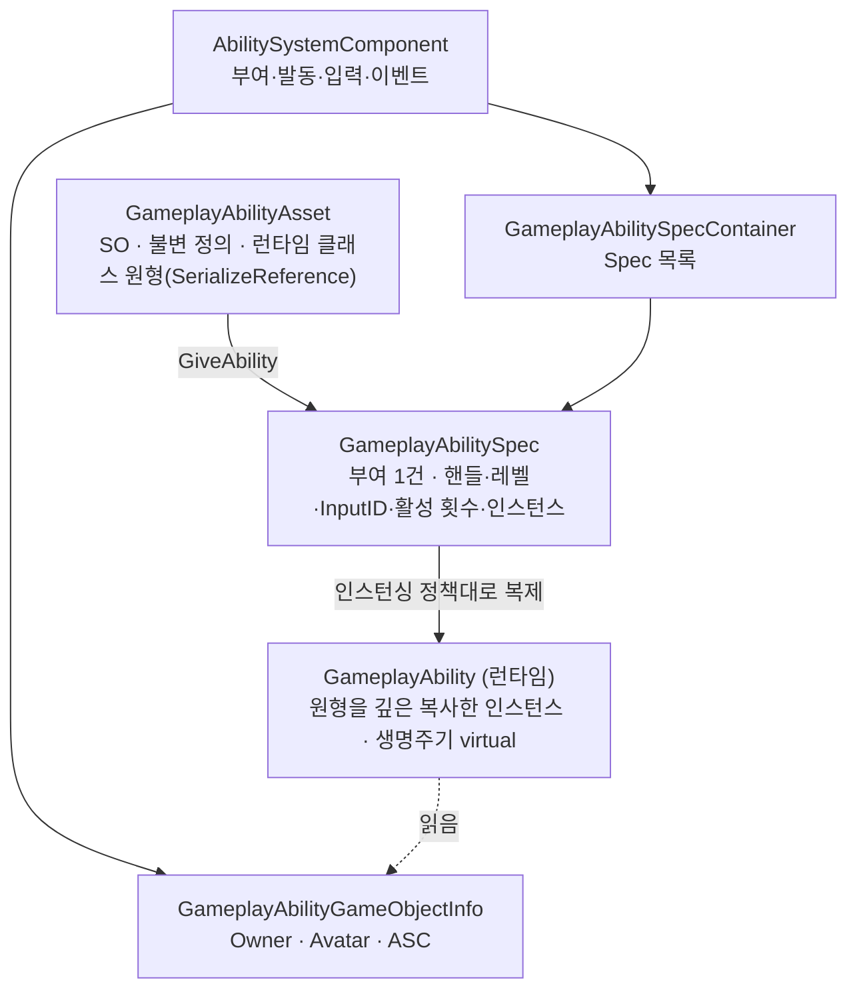
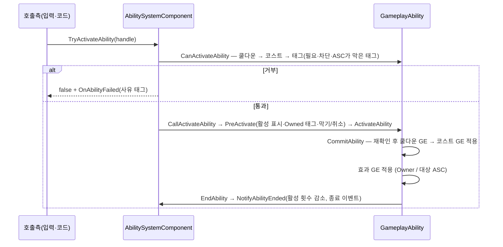
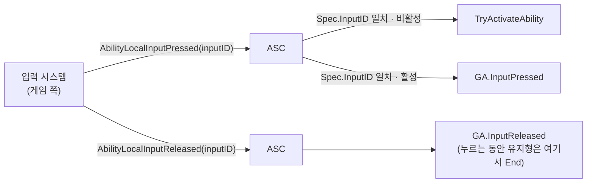

# AbilitySystem — GameplayAbility

> **최종 갱신:** 2026-10-23 (KST)

스킬·액션의 실행 단위. 어빌리티를 ASC에 부여하고, 발동 조건(쿨다운·코스트·태그)을 확인해 발동하고, 효과·코스트·쿨다운을 GameplayEffect로 건 뒤 끝낸다. `Assets/Scripts/Core/AbilitySystem/Abilities/`. 상위 개요는 [overview](overview.md).

> UE GAS의 `UGameplayAbility`·`FGameplayAbilitySpec`·ASC 어빌리티 API를 참고해 재구현. **개념·방향** 중심 — 필드·선언 세부는 코드를 본다.

범례: ✅ 구현 · 🔜 계획 · ❌ 미채택

## 구성 요소



| 타입 | 역할 | UE |
|---|---|---|
| `GameplayAbilityAsset` | 불변 정의(SO). 런타임 클래스 인스턴스를 `[SerializeReference]` 원형으로 든다 | `UGameplayAbility` 클래스·CDO |
| `GameplayAbility` | 런타임 로직. 하위 클래스를 만들어 `ActivateAbility`를 채운다 | `UGameplayAbility` 인스턴스 |
| `GameplayAbilitySpec` / `GameplayAbilitySpecHandle` | 부여 1건의 상태 / 그 식별자(전역 유일 id) | `FGameplayAbilitySpec` / `FGameplayAbilitySpecHandle` |
| `GameplayAbilitySpecContainer` | ASC가 가진 Spec 목록 | `FGameplayAbilitySpecContainer` |
| `GameplayAbilityGameObjectInfo` | Owner·Avatar GameObject와 ASC | `FGameplayAbilityActorInfo`(축소) |
| `GameplayAbilitiesSettings` | 발동 실패 사유 태그 설정(SO, Resources 고정 경로) | `UGameplayAbilitiesDeveloperSettings` |

## 정의와 런타임 — 원형 복제

UE는 블루프린트 클래스 하나가 정의(CDO 기본값)이자 런타임 클래스다. Unity의 ScriptableObject는 공유 데이터용이라 객체마다 상태를 들 수 없어, 둘로 나눈다.

- **정의(`GameplayAbilityAsset`)** — 에셋 하나. 런타임 클래스(`GameplayAbility` 하위)의 인스턴스를 `[SerializeReference]` 원형으로 저장해, 하위 클래스의 직렬화 필드가 에셋 인스펙터에 그려지고 에셋마다 저장된다.
- **런타임(`GameplayAbility`)** — `[Serializable]` 일반 C# 클래스. 부여·발동 때 원형을 **Unity 직렬화 규칙대로 깊은 복사**(`SerializedDeepCopy`)한다 — 값·리스트·중첩 `[Serializable]`은 새로, `UnityEngine.Object` 참조와 `SerializeReference` 공유 관계는 유지. 복사 뒤 `OnAfterDeserialize`를 불러 캐시(태그 부모·해시 등)를 다시 만든다.
- 정책·코스트·쿨다운·태그 같은 정의 필드는 런타임 base 클래스의 직렬화 필드다 — 원형에 저장되고 ASC는 원형에서 읽는다.

## 인스턴싱 정책

| 정책 | 인스턴스 | 부여·해제·발동 확인 콜백을 받는 쪽 | 상태 |
|---|---|---|---|
| `InstancedPerGameObject` | 부여 때 하나, 해제 때까지 | 그 인스턴스 | ✅ |
| `InstancedPerExecution`(기본값) | 발동마다 새로, 끝나면 버림 | 에셋 원형(UE CDO 역할) — 원형엔 GameObject 정보를 쓰지 않는다 | ✅ |
| `NonInstanced` | — | — | ❌ |

원형은 모든 GameObject가 공유하므로, 원형 쪽 콜백에서 상태를 쓰지 않는다(UE CDO와 같은 규칙).

## 생명주기



- **발동 확인** — 쿨다운은 쿨다운 GE의 부여 태그를 가졌는지, 코스트는 GE 컨테이너가 "AddBase 모디파이어를 적용해도 0 이상인가"로 본다(`CanApplyAttributeModifiers`). 실패 사유는 설정 에셋의 사유 태그(`Ability.ActivateFail.*`)로 모은다.
- **커밋** — UE처럼 코스트·쿨다운은 커밋 때만 적용된다. 발동 안에서 `CommitAbility`가 실패하면 보통 취소로 끝낸다.
- **취소** — `CancelAbility` = 취소 표시로 `EndAbility`. 활성 중 해제되면 `EndAbility`(취소 아님) 뒤 해제 알림.
- **스코프 락** — 발동·해제 도중 목록이 바뀌지 않게 락을 걸고, 락 중 부여·해제는 보류했다가 마지막 락이 풀릴 때 처리한다.

## GE 연결

어빌리티는 수치를 직접 바꾸지 않고 GE를 건다. 헬퍼는 UE 이름 그대로다.

- `MakeEffectContext` — Instigator = 이 ASC, EffectCauser = Avatar.
- `MakeOutgoingGameplayEffectSpec` — 어빌리티 레벨로 Spec 생성.
- `ApplyGameplayEffect(Spec)ToOwner` / `ApplyGameplayEffect(Spec)ToTarget(…, 대상 ASC, …)` — 대상은 ASC 하나(UE의 TargetData 대신).

## 태그·차단·취소

| 필드 | 의미 | 상태 |
|---|---|---|
| `activationOwnedTags` | 활성인 동안 Owner에 붙는 태그(루즈 태그로 더하고 뺌) | ✅ |
| `activationRequiredTags` / `activationBlockedTags` | Owner가 가져야 / 가지면 안 되는 태그 | ✅ |
| `assetTags` | 이 어빌리티를 나타내는 태그 — 막기·취소의 대상 판정 | ✅ |
| `blockAbilitiesWithTag` / `cancelAbilitiesWithTag` | 활성인 동안 이 태그의 다른 어빌리티를 막음 / 발동 때 취소 | ✅ |
| Source/Target Required·Blocked 태그 | 이벤트 발동 데이터 전용 | 🔜 |

ASC는 막힌 어빌리티 태그를 개수로 관리해(같은 태그를 둘이 막으면 둘 다 끝나야 풀림) 발동 확인에서 본다.

## 입력



부여 때 Spec에 `InputID`(정수)를 주고, 입력 쪽은 눌림·뗌을 ID로 넘긴다. Spec이 눌림 상태(`InputPressed`)를 든다. 어떤 키가 어떤 ID인지는 게임 쪽이 정한다.

## 이벤트

ASC 이벤트 — `OnAbilityActivated` · `OnAbilityCommitted` · `OnAbilityFailed`(사유 태그) · `OnAbilityEnded`(어빌리티만) · `OnAbilityEndedWithData`(취소 여부 등). 실패 사유 컨테이너는 ASC가 시도마다 비워 쓰므로, 구독자가 보관하려면 복사한다.

## ASC 복제·파괴

- **복제(`Instantiate`)** — 직렬화 설정만 따라가고, 부여된 어빌리티·활성 GE·태그·현재 값은 새로 시작한다(UE의 Transient 목록과 같은 결과).
- **파괴(`OnDestroy`)** — Owner·ASC가 살아 있으면 활성 어빌리티를 모두 취소한 뒤 모두 해제하고, AttributeSet 목록을 비운다.

## 사용 예

하위 클래스는 `ActivateAbility`만 채운다. 발동하면 GE들을 소유자에게 걸고 바로 끝나는 어빌리티:

```csharp
[Serializable]
public sealed class ApplyEffectsAbility : GameplayAbility
{
    [SerializeField] private List<GameplayEffectAsset> effects = new();

    public override void ActivateAbility(GameplayAbilitySpecHandle handle, GameplayAbilityGameObjectInfo gameObjectInfo)
    {
        if (!CommitAbility(handle, gameObjectInfo))
        {
            EndAbility(handle, gameObjectInfo, true);
            return;
        }

        float level = GetAbilityLevel(handle, gameObjectInfo);
        foreach (GameplayEffectAsset effect in effects)
        {
            ApplyGameplayEffectToOwner(handle, gameObjectInfo, effect, level);
        }

        EndAbility(handle, gameObjectInfo, false);
    }
}
```

부여·발동:

```csharp
// 부여 — 입력 ID를 주면 입력으로 발동된다
GameplayAbilitySpecHandle handle = asc.GiveAbility(new GameplayAbilitySpec(abilityAsset, inputID: 1));

// 입력으로 발동
asc.AbilityLocalInputPressed(1);

// 코드로 발동
asc.TryActivateAbility(handle);
```

## 진입점 (Entry Points)

| 목적 | API | 위치 |
|---|---|---|
| 부여·해제 | `GiveAbility(spec)` · `ClearAbility(handle)` · `ClearAllAbilities()` | `AbilitySystemComponent.cs` |
| 조회 | `FindAbilitySpecFromHandle` · `FindAbilitySpecFromAsset` · `GetActivatableAbilities` | 〃 |
| 발동·취소 | `TryActivateAbility(handle)` · `CancelAbility(asset)` · `CancelAbilityHandle(handle)` · `CancelAllAbilities()` | 〃 |
| 입력 | `AbilityLocalInputPressed/Released(inputID)` | 〃 |
| 막기 | `BlockAbilitiesWithTags` · `UnBlockAbilitiesWithTags` · `AreAbilityTagsBlocked` | 〃 |
| GameObject 정보 | `InitAbilityGameObjectInfo(owner, avatar)` | 〃 |
| 어빌리티 로직 | `ActivateAbility` · `CommitAbility` · `EndAbility` · `InputPressed/Released` (override) | `Abilities/GameplayAbility.cs` |
| 남은 쿨다운 | `GetCooldownTimeRemaining(AndDuration)` | 〃 |

## UE ↔ Unity 대응

| UE GAS | 이 프로젝트 | 대응 시 판단 / 차이 |
|---|---|---|
| `UGameplayAbility`(클래스 = 정의 + 런타임) | `GameplayAbilityAsset`(SO) + `GameplayAbility`(C# 클래스) | SO는 공유 데이터라 런타임 상태를 따로 둠. 원형은 `SerializeReference` |
| CDO | 에셋 원형 | Per Execution의 부여·해제·발동 확인 콜백을 원형이 받음 |
| `NewObject(CDO)` | 직렬화 규칙 깊은 복사 | 엔진 클래스(AnimationCurve 등)는 원형과 공유 |
| 인스턴싱 3종 | Per GameObject · Per Execution | `NonInstanced` 미채택 |
| `FGameplayAbilityActorInfo` | `GameplayAbilityGameObjectInfo` | PlayerController·Mesh·Anim 등 없음 |
| `FGameplayAbilityTargetDataHandle` | 대상 ASC 하나 | 타겟팅 미채택 |
| `UAbilityTask` · AbilityTriggers · GameplayEvent 발동 | (없음) | 🔜 |
| Generic Confirm/Cancel 입력 · 복제 입력 이벤트 | (없음) | ❌(네트워크) |
| 예측·복제(`ActivationInfo`·`PredictionKey`) | (없음) | ❌ 로컬 전용 |
| `bIsAbilityEnding`·`CanBeCanceled` | (없음) | 재진입 경로·취소 불가 구간이 없어 뺌 |
