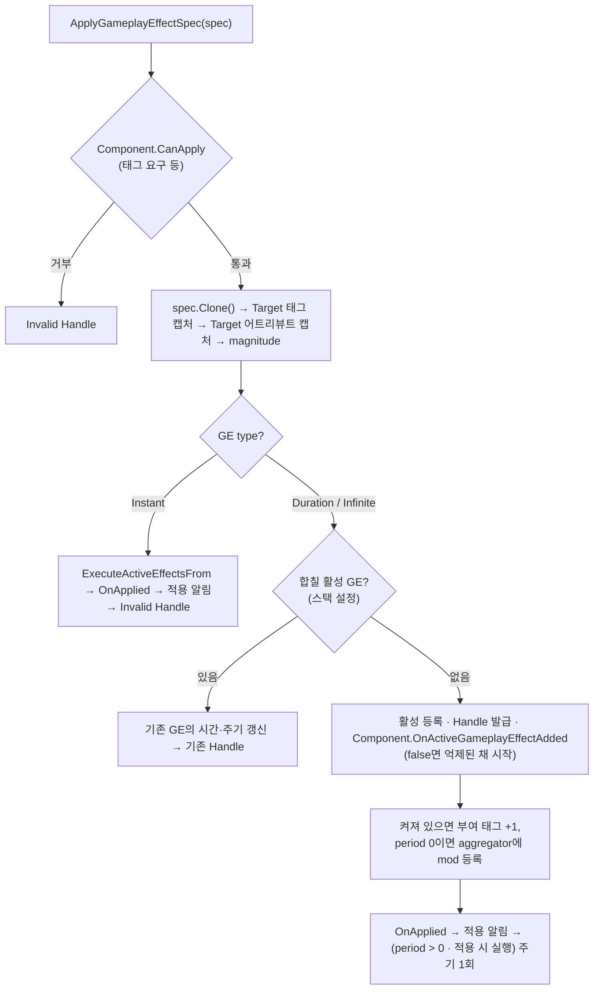
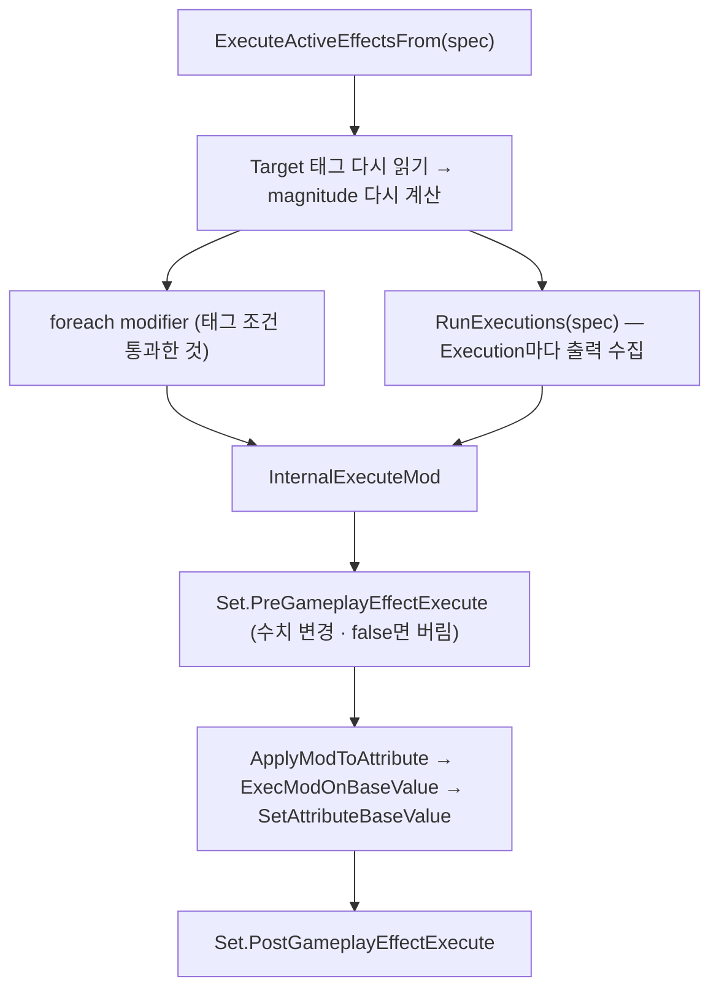

# AbilitySystem — GameplayEffect

> **최종 갱신:** 2026-10-23 (KST)

수치 변경을 통과시키는 단일 채널. 상위 개요는 [overview](overview.md), 대상 수치는 [attribute](attribute.md), 라이브 재평가는 [aggregator](aggregator.md), 태그 연동은 [gameplay-tag](gameplay-tag.md).

> UE GAS의 GameplayEffect를 참고해 **필요한 축만 직접 구현** — UE 대비 채택/생략은 [overview §UE GAS 대비](overview.md#ue-gas-대비--채택생략).
> 이 문서는 **개념·방향** 중심이다. 필드·에셋 작성 절차 등 세부는 코드를 본다.

## 정의 ↔ 런타임 (Asset ↔ Spec)

- **`GameplayEffectAsset`(SO):** "무엇을·얼마나·어떻게" 바꿀지의 **불변 정의** — 타입·지속/주기, 스택 설정, Component 목록, Modifier 목록, Execution 목록, 메모용 설명.
- **`GameplayEffectSpec`(런타임):** 적용 시 Asset으로부터 만드는 인스턴스 — 레벨·컨텍스트·지속 시간·캡처값·계산된 magnitude·캡처 태그. 적용 경계에서 **대상별로 복제(Clone)**돼 대상 캡처값이 섞이지 않는다.
- **`ActiveGameplayEffect`:** 지속형 GE의 활성 상태(적용 시각·남은 시간·주기 타이머·억제 여부)를 들고 컨테이너에 등록. 핸들로 식별·해제.

**왜 나누나:** 하나의 Asset을 여러 대상이 공유하므로, 런타임 가변 상태(캡처값·타이머)는 Spec 쪽에 둬야 서로 간섭하지 않는다. Execution도 같은 이유로 '데이터(SO)'가 아니라 '로직(순수 클래스)'이며 무상태다.

## Modifier

한 Modifier는 **어트리뷰트 하나를 어떻게 바꿀지**의 최소 단위다 — 대상 어트리뷰트 + 연산 + magnitude + (선택) Source/Target 태그 조건.

### 정의 ↔ 런타임 슬롯

| | 타입 | 담는 것 |
|---|---|---|
| 정의 | `GameplayModifier` (Asset의 `Modifiers`) | 대상 `GameplayAttribute` · 연산 · `GameplayEffectModifierMagnitude` · Source/Target 태그 조건 |
| 런타임 | `GameplayModifierSpec` (`struct` 슬롯) | 평가된 `EvaluatedMagnitude` 하나 |

둘은 **같은 인덱스로 평행한 배열**이다(`Modifiers[i]` ↔ `Definition.Modifiers[i]`). 대상·연산은 불변 정의가 들고, 대상·캡처마다 달라지는 **계산된 수치**만 런타임 슬롯이 든다.

### magnitude 계산 (`GameplayEffectModifierMagnitude`)

GE Modifier와 Execution의 Calculation Modifier가 같은 구조체를 쓴다.

| 계산 방식 | 내용 | 상태 |
|---|---|---|
| `ScalableFloat` | 고정 float | ✅ (레벨 커브 🔜) |
| `AttributeBased` | `(capturedValue + PreMultiplyAdditive) * Coefficient + PostMultiplyAdditive` — 값을 어디서·어떻게 가져오는지는 → [capture](capture.md) | ✅ |
| `CustomCalculationClass` · `SetByCaller` | 인스펙터 자리만, 계산 실패 → 0 + 경고 | 🔜 |

magnitude는 **적용 시 Target 캡처 직후**와 **주기 실행마다** `CalculateModifierMagnitudes`가 채운다. 지속형에서 캡처 대상이 바뀌면 aggregator가 다시 계산한다 → [aggregator](aggregator.md).

### 연산 (`GameplayModifierOperation` 6종)

| 연산 | 값에 하는 것 |
|---|---|
| `AddBase` | 곱셈 전 합 |
| `MultiplyAdditive` | 배율 누산 `1 + Σ(m−1)` (1.5x + 1.5x = 2.0x) |
| `DivideAdditive` | 제수 누산 (분모에 같은 방식) |
| `MultiplyCompound` | 배율 곱산 `Π m` (1.5x · 1.5x = 2.25x) |
| `AddFinal` | 곱셈 후 합 |
| `Override` | 최종값 대체 |

결합 공식은 aggregator가 소유한다 → [aggregator](aggregator.md).

### 태그 조건

Modifier의 Source/Target 태그 조건(`GameplayTagRequirements` — Require·Ignore·Query)은 경로마다 판정 시점이 다르다(UE와 같음): Instant·Periodic은 실행할 때의 액터 태그로 그 modifier를 건너뛰고, 지속형은 조건째 aggregator에 들어가 평가 문맥으로 판정된다(CurrentValue는 빈 문맥) → [gameplay-tag](gameplay-tag.md).

## 값 변경의 두 경로 — BaseValue vs CurrentValue

- **영구 변경(BaseValue):** 데미지·힐 같은 소모. Base에 직접 적용돼 남는다.
- **일시 보정(CurrentValue):** 장비·버프 같은 지속 효과. Base는 두고 활성 mod를 모아 CurrentValue를 산출 → 해제하면 정확히 원복.

갈림의 축은 **타입이 아니라 `period`** 다 — 주기 실행은 매 주기가 작은 영구 변경이라 영구 경로에 묶인다.

| 타입 | `period` | 무엇이 바뀌나 | 해제 시 |
|---|---|---|---|
| Instant | — | BaseValue (영구) | 활성 목록에 없음 |
| Duration / Infinite | `> 0` | BaseValue (주기마다 영구) | 반영된 값은 남음 |
| Duration / Infinite | `0` | CurrentValue만 | 원복 |

## 적용 흐름



- **억제(inhibit):** 켜진 GE만 modifier·부여 태그를 건다. 꺼지면 거두고 주기 실행·magnitude 갱신을 건너뛴다. Target Tag Requirements Component가 소유 태그를 구독해 켜고 끈다.
- **알림 순서:** UE는 적용 시 주기 실행을 다음 틱으로 미뤄 부여 태그·OnApplied·적용 알림이 먼저다. 바로 실행하는 우리도 그 뒤에 둬 같은 순서를 보게 한다.

## Execute 경로 (영구 변경)

Instant/주기형이 타는 경로. Modifier와 Execution 출력을 BaseValue에 적용한다.



**쓰기 경로 단일화:** Modifier와 Execution 출력이 같은 `InternalExecuteMod`를 거친다 — 경로별 지원 연산이 어긋나지 않고, Set 훅(클램프·meta attribute·사망 판정)이 한 곳에서 불린다. 값 변경 이벤트에는 원인(`GameplayEffectModCallbackData` — Spec·수치·대상)이 실린다.

## 수명 (Tick)

- 적용 시각(`StartWorldTime`)을 기록하고, Tick은 GE마다 **적용(또는 지난 Tick) 뒤 흐른 시간만** 센다 — 프레임 도중에 걸린 GE가 그 프레임 시간까지 깎이지 않는다.
- 남은 시간은 `Duration − (지금 − StartWorldTime)`으로 매번 다시 계산(float 오차가 쌓이지 않음). 만료는 Tick 때 한꺼번에 제거.
- 주기형은 주기마다 실행(프레임이 길면 밀린 주기를 몰아 실행). Infinite는 수동 해제까지.
- 시계는 컨테이너가 읽는 `Time.time`이라 `timeScale`을 따른다.

## 스택 (스택 수 1)

| 설정 | 의미 |
|---|---|
| `stackingType` = None | 같은 GE를 다시 걸면 활성 GE가 하나 더 생긴다 |
| AggregateByTarget | 대상에 같은 GE가 있으면 합친다 |
| AggregateBySource | 같은 시전자 ASC가 건 같은 GE만 합친다 |
| `stackDurationRefreshPolicy` | 합칠 때 지속 시간을 처음부터 다시 셀지 |
| `stackPeriodResetPolicy` | 합칠 때 주기 타이머를 리셋할지(리셋하면 "적용 시 실행"도 다시) |

합칠 때 새 GE를 만들지 않고 **기존 GE의 시간만** 갱신한다 — Spec·modifier·부여 태그는 처음 것 그대로다. UE는 기존 Spec을 새 Spec으로 바꾸고 스택 수를 더한다. 스택 수 2 이상(상한·스택 수만큼 세기·만료 정책)은 🔜.

## Context · Spec 부가 정보

- **Context(`GameplayEffectContext`)** — Instigator(시전자 ASC)·EffectCauser·SourceObject, **피격 정보**(`AddHitResult`/`TryGetHitResult` — `RaycastHit` 하나). Execution이 맞은 위치·콜라이더를 읽을 수 있다.
- **대상별 복제** — 한 Spec을 여러 대상에 걸 땐 대상마다 `Clone()` + 컨텍스트 `Duplicate()` + `SetContext`로 피격 정보를 따로 담는다(UE TargetData 적용과 같은 이유 — 안 하면 공유 컨텍스트에 마지막 대상 정보가 남는다).
- **지속 시간** — Spec이 정의 값으로 시작하는 `Duration`을 들고, 적용 전에 `SetDuration`으로 바꿀 수 있다(예: 쿨다운을 공격속도로 나누기). 에셋 쪽 Duration Magnitude·지속 시간 캡처는 없다.

## Execution — 복합 계산 훅

단순 Modifier로 표현하기 어려운 계산(분기·클램프·다중 어트리뷰트, 예: `받는 피해 = Source 공격력 × 배율`)을 담는 **추상 클래스**. 무상태 로직이라 Asset은 계산 클래스 이름(AQN)만 저장하고 Spec 생성 시 인스턴스화한다. **Instant/주기형에서만 실행** — 지속형(period 0)의 상시 계산은 AttributeBased Modifier가 맡는다.

- **정의(`GameplayEffectExecutionDefinition`)** — 계산 클래스 + **Calculation Modifiers**(캡처 대상·연산·magnitude·태그 조건). Calculation Modifier의 대상은 그 클래스가 `Defs()`로 선언한 캡처 중에서 고르고, 실행 때 캡처 aggregator **사본**에 더해져 Execution이 읽는다(실제 값은 그대로).
- **`virtual Defs()`** — 캡처할 어트리뷰트 선언. Spec이 읽어 캡처 컨테이너에 등록한다 → [capture](capture.md).
- **`GameplayEffectExecutionParameters`**(입력) — `TargetAsc` · `SourceAsc` · `Spec`, `AttemptCalculateCapturedAttributeMagnitude(def, 평가 파라미터, out)` / `...BaseValue(def, out)`.
- **`GameplayEffectExecutionOutput`**(출력) — `AddOutputModifier(handle, magnitude, op)`. 출력은 일반 Modifier와 같은 `InternalExecuteMod` 경로를 탄다. Execution마다 끝나는 즉시 반영돼 뒤 Execution이 앞 결과를 본다.

```csharp
public sealed class DamageExecution : GameplayEffectExecution
{
    private static readonly GameplayEffectAttributeCaptureDefinition AttackDef =
        new(CharacterAttributeSet.Attack, AttributeCaptureSource.Source, true);
    private static readonly GameplayEffectAttributeCaptureDefinition[] CaptureDefs = { AttackDef };

    public override ReadOnlySpan<GameplayEffectAttributeCaptureDefinition> Defs()
    {
        return CaptureDefs;
    }

    public override void Execute(GameplayEffectExecutionParameters parameters, GameplayEffectExecutionOutput output)
    {
        if (!parameters.AttemptCalculateCapturedAttributeMagnitude(AttackDef, default, out float attack))
        {
            return;
        }

        output.AddOutputModifier(CharacterAttributeSet.Health, -attack, GameplayModifierOperation.AddBase);
    }
}
```

> 캡처 조회는 실패 시 `false`+`0`이다 — 반환 bool을 확인하지 않으면 0이 계산에 샌다.

## GE Component

GE의 부가 동작은 `[SerializeReference]` Component 목록으로 붙인다(UE 5.3+ 구조). Component는 GE 적용 흐름의 정해진 지점(`CanGameplayEffectApply`·`OnActiveGameplayEffectAdded`·`OnGameplayEffectExecuted`·`OnGameplayEffectApplied`·`OnGameplayEffectChanged`)에서 불린다(UE와 같은 이름).

| Component | 하는 일 | 상태 |
|---|---|---|
| Asset Tags | GE를 나타내는 태그(질의·Source 태그에 쓰임) | ✅ |
| Granted Tags(Target Tags) | 활성인 동안 대상에 붙는 태그 | ✅ |
| Target Tag Requirements | 적용·유지·제거의 태그 조건 | ✅ |
| Remove Other | 적용될 때 질의에 맞는 다른 GE 제거(자기는 모든 질의에서 제외) | ✅ |
| Chance to Apply · Additional Effects · Custom Can Apply | — | 🔜 |

상세는 → [gameplay-tag](gameplay-tag.md).

## 질의·이벤트

- **`GameplayEffectQuery`** — 태그 질의 4종(Owning·Effect·Source·Applied)·ModifyingAttribute·EffectSource·EffectDefinition + 무시 핸들·코드 델리게이트. ASC가 찾기·개수·남은 시간·끝나는 시각·레벨 변경·제거(`RemoveActiveEffectsWith…Tags`) API를 UE 이름으로 연다.
- **이벤트** — 어트리뷰트 값 변경(`GetGameplayAttributeValueChangeDelegate(handle).OnValueChange` — 값이 같아도), ASC `OnGameplayEffectAppliedToSelf` · `OnPeriodicGameplayEffectExecuteOnSelf` · `OnAnyGameplayEffectRemoved`, 활성 GE별 `OnEffectRemoved`.
- **조회** — `GetActiveGameplayEffects()`(읽기 전용, 열거 중 적용·제거 금지).

## 진입점 (Entry Points)

| 목적 | API | 위치 |
|---|---|---|
| 컨텍스트·Spec 생성 | `MakeEffectContext()` · `MakeOutgoingSpec(effect, ctx, level)` | `AbilitySystemComponent.cs` |
| GE 적용(자신/대상) | `ApplyGameplayEffectToSelf` · `ApplyGameplayEffectToTarget` · `ApplyGameplayEffectSpecToSelf/ToTarget` | 〃 |
| 해제 | `RemoveActiveGameplayEffect(handle)` · `RemoveActiveEffects(query)` | 〃 |
| 질의 | `GetActiveEffects(query)` · `GetActiveEffectsTimeRemaining(query)` 등 | 〃 |
| 코스트 확인 | `CanApplyAttributeModifiers(effect, level, context)` | 〃 |
| 억제 | `SetActiveGameplayEffectInhibit(handle, inhibit)` | 〃 |

`SpecHandle`은 두지 않는다 — Spec이 이미 class라 래퍼 이득이 없다. 실제 소유·수명·집계는 ASC가 아니라 `ActiveGameplayEffectsContainer`가 맡고 ASC는 얇은 위임 래퍼다.

## UE ↔ Unity 대응

| UE GAS | 이 프로젝트 | 대응 시 판단 / Unity 제약 |
|---|---|---|
| `UGameplayEffect` (정의) | `GameplayEffectAsset` (ScriptableObject) | 정의를 데이터 에셋으로. 런타임 타입과 구분하려 `Asset` 접미어 |
| `FGameplayEffectSpec` | `GameplayEffectSpec` (class) | 정의/런타임 분리 그대로. 대상별 복제는 명시적 `Clone()` |
| `FActiveGameplayEffect` | `ActiveGameplayEffect` | 적용 시각 기반 수명. UE의 GE별 타이머 대신 컨테이너 Tick 한 루프 |
| `FGameplayModifierInfo` / `FGameplayEffectModifierMagnitude` | `GameplayModifier` / `GameplayEffectModifierMagnitude` | 연산 6종으로 축소 |
| `UGameplayEffectExecutionCalculation` + `FGameplayEffectExecutionDefinition` | `GameplayEffectExecution` + `GameplayEffectExecutionDefinition` | SO가 임의 클래스를 못 담아 AQN으로 저장. `PassedInTags`·Conditional GE·Transient 집계기 없음 |
| `UGameplayEffectComponent` | `GameplayEffectComponent` | 같은 훅 지점 |
| 스택(`StackingType`·갱신 정책·스택 수) | 스택 수 1 | 합치기·시간 갱신만 |
| `FGameplayEffectQuery` | `GameplayEffectQuery` | 블루프린트 델리게이트·서버 권한 검사 없음 |
| `FGameplayEffectContext::AddHitResult` · `Duplicate` | 같음(`RaycastHit` 하나) | Origin·공유 포인터 없음 |
| `FGameplayEffectSpec::SetDuration` | `SetDuration` | 잠금·지속 시간 캡처 없음 |
| `FGameplayEffectSpecHandle` | (생략) | Spec이 이미 class |
| Gameplay Cue | (없음) | 🔜 |

> 원칙은 [overview](overview.md)의 "UE GAS의 선택적 이식" — 개념·방향을 따르되, UE 고유 제약(UObject·네트워크)에서 온 구현은 그 제약이 없으면 Unity 관용에 맞춰 다시 정한다.

## 미구현

| 항목 | 내용 |
|---|---|
| GE 스택 수 2 이상 | 상한·스택 수만큼 modifier 세기·만료 정책 |
| Gameplay Cue | GE 적용/해제 시 연출 트리거 |
| ScalableFloat 커브 | Magnitude를 Level 커브로 (현재 고정 float) |
| Magnitude 확장 | `SetByCaller` · `CustomCalculationClass` |
| Execution 부가 | Transient 집계기 · `PassedInTags` · Conditional GE |
| 부가 Component | Chance to Apply · Additional Effects |
| 데이터 검증 | 잘못된 GE 조합을 에디터에서 알리는 체계(UE `IsDataValid`) |
