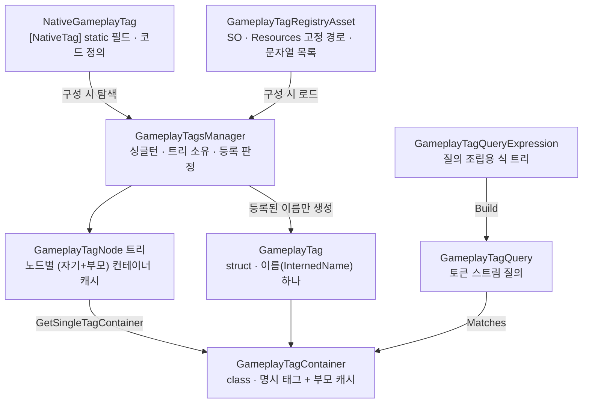
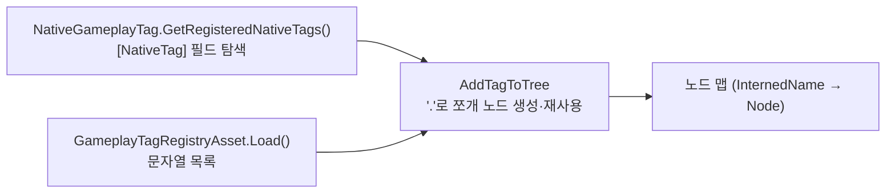
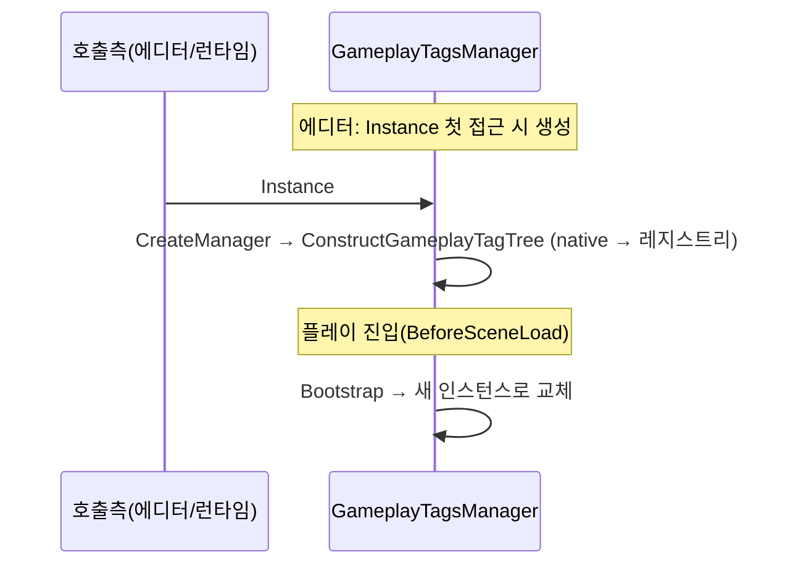

# AbilitySystem — GameplayTag

> **최종 갱신:** 2026-10-14 (KST)

`Assets/Scripts/Core/AbilitySystem/Tag/` — 계층 문자열(`Status.Debuff.Stun`)로 상태를 표현하는 태그 시스템. 태그 정의 → 트리 구성 → 획득 → 매칭(단일·컨테이너·질의)까지를 다룬다. 상위 개요 [overview](overview.md).

> UE `GameplayTags` 모듈(`UGameplayTagsManager`·`FGameplayTag`·`FGameplayTagContainer`·`FGameplayTagQuery`)의 런타임 API를 기준으로 재구현. 에디터 툴링(태그 피커·편집 UI)은 이 문서 범위 밖.
> ⚠ 2026-10-12 기준 **Unity 컴파일·동작 미검증** 상태의 코드를 정리한 문서다.

범례: ✅ 구현 · 🔜 계획 · ❌ 미채택

## 구성 요소



| 타입 | 역할 | UE |
|---|---|---|
| `GameplayTagsManager` | 태그 트리 소유, 등록 판정, 계층 조회 | `UGameplayTagsManager` |
| `GameplayTagNode` | 트리 노드. 단순 이름·부모·자식 + (자기+부모) 컨테이너 캐시 | `FGameplayTagNode` |
| `GameplayTag` | 단일 태그 식별자(이름 하나) | `FGameplayTag` |
| `GameplayTagContainer` | 태그 집합 + 부모 캐시. 매칭 단위 | `FGameplayTagContainer` |
| `GameplayTagQuery` / `GameplayTagQueryExpression` | 논리 질의(All/Any/None 조합) / 조립용 식 | `FGameplayTagQuery` / `FGameplayTagQueryExpression` |
| `NativeGameplayTag` + `NativeTagAttribute` | 코드에서 정의하는 태그 | `FNativeGameplayTag` (`UE_DEFINE_GAMEPLAY_TAG`) |
| `GameplayTagRegistryAsset` | 에셋에 저장하는 태그 정의 목록 | `DefaultGameplayTags.ini` (`UGameplayTagsSettings`) |

---

## 1. 태그 정의·등록

태그는 두 출처에서 정의되고, 매니저가 트리를 만들 때 **native → 레지스트리 순**으로 넣는다. 같은 경로는 한 노드로 합쳐지고, 리프만 등록해도 중간 부모 노드가 자동 생성된다.



| 출처 | 정의 방식 | 저장 | 상태 |
|---|---|---|---|
| 레지스트리 에셋 | `Resources/AbilitySystem/GameplayTagRegistry` 의 문자열 목록(전체 경로 한 줄씩) | 에셋(SO) | ✅ |
| native | `[NativeTag] public static readonly NativeGameplayTag X = new("A.B");` | **저장 안 함** — 구성마다 코드에서 다시 탐색 | ✅ |

- **native 탐색:** 에디터는 `TypeCache.GetFieldsWithAttribute<NativeTagAttribute>()`, 빌드는 로드된 어셈블리 전체 리플렉션. 필드 값을 읽을 때 선언 클래스의 static 초기화가 실행된다.
- **UE와 다른 점:** UE는 전역 `FNativeGameplayTag` 생성자가 모듈 로드 시 자기 등록한다. C# static 필드는 타입 첫 접근 시에야 초기화되므로 마커 기반 **명시적 탐색**으로 대체했다.
- **레지스트리 에셋 생성:** 에디터 로드·재컴파일 시 `[InitializeOnLoad]`(`GameplayTagRegistryInitializer`)가 없으면 만든다. 런타임은 읽기만 한다.

| 계획 🔜 | 내용 |
|---|---|
| 노드 출처·명시/암시 기록 | 노드가 native/레지스트리 중 어디서 왔는지, 직접 등록인지 중간 부모로 생긴 것인지 (UE: `SourceNames`·`bIsExplicitTag`) — 편집 UI 착수 시 |
| 레지스트리 편집 시 트리 재구성 | 에디터 매니저는 재컴파일·플레이 진입 전까지 이전 트리를 쓴다 (UE: `EditorRefreshGameplayTagTree`) |
| IL2CPP 코드 제거 대응 | 참조 없는 마커 필드가 빌드에서 빠질 수 있음 |

## 2. 태그 획득 — 등록된 이름만

`GameplayTag` 생성자는 private이다. 외부 코드가 태그를 얻는 길은 아래뿐이고, 모두 **트리에 있는 이름**에서만 유효한 태그가 나온다.

| 진입점 | 동작 | UE |
|---|---|---|
| `GameplayTag.RequestGameplayTag(string / InternedName, errorIfNotFound = true)` | 트리에 있으면 태그, 없으면 빈 태그(`default`). `errorIfNotFound`면 미등록 이름을 이름당 한 번 에러 로그 | `FGameplayTag::RequestGameplayTag` |
| `GameplayTagsManager.Get().RequestGameplayTag(InternedName, errorIfNotFound = true)` | 위와 같음(위 정적 함수가 위임) | `UGameplayTagsManager::RequestGameplayTag` |
| `NativeGameplayTag.GetTag()` / 암시적 변환 | native 정의를 태그로. 마커 없이 만든 인스턴스는 트리에 없어 빈 태그 | `FNativeGameplayTag` → `FGameplayTag` |
| `default(GameplayTag)` | 빈 태그("태그 없음"). `IsValid()` false | `FGameplayTag()` / `EmptyTag` |

- 매니저 내부 생성은 `internal static GameplayTag.Create` 하나로 한다. 현재 단일 어셈블리라 `internal`이 실제로 막지는 못하며, AbilitySystem 어셈블리 분리 시 실효를 갖는다. (UE: protected 생성자 + friend)
- 로드된 데이터(직렬화된 `GameplayTag` 필드)는 생성자를 거치지 않으므로 미등록 이름이 들어올 수 있다. 이런 태그로 매칭하면 `Debug.LogError`를 내고 false를 돌려준다(UE: ensure).

| 계획 🔜 | 내용 |
|---|---|
| 로드 시 미등록 경고 | 에셋 로드 시점에 미등록 이름을 알림 (UE: `WarnOnInvalidTags`) |
| 인스펙터 드롭다운 | 등록된 태그만 고르는 드로어 (UE: `SGameplayTagPicker`) |
| 대소문자 무시 비교 + 표기 보존 | UE `FName`식 — `InternedName` 쪽 작업 |

## 3. 단일 태그 매칭·계층 조회

부모 매칭은 트리를 타지 않고 **노드의 (자기+부모) 컨테이너 캐시**를 읽는다. 매칭 함수는 노드가 필요하므로 미등록 태그에는 답하지 않는다.

| 진입점 (`GameplayTag`) | 의미 | 예 |
|---|---|---|
| `MatchesTag(t)` | 이 태그가 `t`이거나 그 자식 | `"A.1".MatchesTag("A")` → true, 반대 → false |
| `MatchesTagExact(t)` | 정확히 같음 | `"A.1".MatchesTagExact("A")` → false |
| `MatchesTagDepth(t)` | 루트부터 같은 단계 수 | `"A.B.C"` vs `"A.B.D"` → 2 |
| `MatchesAny(c)` / `MatchesAnyExact(c)` | 컨테이너 태그 중 하나와 매칭(부모 포함 / 정확) | 빈 컨테이너면 false |
| `GetSingleTagContainer()` | 자기+부모 컨테이너의 **사본** | 미등록이면 빈 컨테이너 |
| `RequestDirectParent()` | 바로 위 부모 | 최상위·미등록 → 빈 태그 |
| `GetGameplayTagParents()` | 자기와 모든 부모를 명시로 담은 컨테이너 | `"A.B.C"` → {A.B.C, A.B, A} |
| `ParseParentTags(list)` | 이름을 쪼개 부모를 더함(트리 안 거침) | 바로 위 부모부터 |
| `GetTagLeafName()` | 마지막 구간 | `"A.B.C"` → `C` |

| 진입점 (`GameplayTagsManager`) | 의미 |
|---|---|
| `RequestGameplayTagParents(t)` / `RequestGameplayTagChildren(t)` | 자기+모든 부모 / 모든 자손(자기 제외) 컨테이너 |
| `RequestGameplayTagDirectParent(t)` | 바로 위 부모 |
| `ExtractParentTags(t, list)` | 부모를 중복 없이 더함. 미등록이면 이름 파싱으로 대체 |
| `GameplayTagsMatchDepth(a, b)` · `GetNumberOfTagNodes(t)` · `GetNumGameplayTagNodes()` | 공통 깊이 · 태그 깊이 · 전체 노드 수 |
| `FindTagNode(t)` | 노드 조회. 노드 접근자: `GetCompleteTag`·`GetSimpleTagName`·`GetParentTagNode`·`GetChildTagNodes`·`GetSingleTagContainer`(트리 캐시 — 읽기 전용으로만 사용) |

## 4. 컨테이너

명시 태그(`AddTag`로 넣은 것)와 그 **부모 캐시**를 함께 든다. 부모 캐시 덕분에 `{"A.1"}.HasTag("A")`가 리스트 조회만으로 true가 된다. `class`라 대입은 참조 공유이고, 복사는 복사 생성자로 명시한다(UE는 값 타입).

**매칭**

| 진입점 | 의미 | 대상이 비었을 때 |
|---|---|---|
| `HasTag(t)` / `HasTagExact(t)` | 명시 또는 부모로 있음 / 명시로만 있음 | — (무효 태그는 false) |
| `HasAny(c)` / `HasAnyExact(c)` | 하나라도 있음 | false |
| `HasAll(c)` / `HasAllExact(c)` | 모두 있음 | true |
| `MatchesQuery(q)` | 질의 만족 | — |
| `Equals(c)` | 순서 무관하게 같은 명시 태그 | — |

**변경**

| 진입점 | 동작 |
|---|---|
| `AddTag(t)` / `AddTagFast(t)` | 중복 없이 추가 + 부모 캐시 갱신 / 중복·유효성 검사 없이 추가 |
| `AddLeafTag(t)` | 가장 구체적인 태그만 유지 — 부모가 명시돼 있으면 빼고 추가, 더 구체적인 자식이 있으면 실패 |
| `RemoveTag(t, defer)` / `RemoveTags(c)` | 제거 후 부모 캐시를 처음부터 재계산(같은 부모를 다른 태그가 줄 수 있어서). `defer`면 재계산을 미루고 호출측이 `FillParentTags()` |
| `AppendTags(c)` / `AppendMatchingTags(a, b)` | 합치기 / `a` 중 `b`와 매칭되는 것만 추가 |
| `Reset()` | 비우기 |

**조회** — `Num()` · `IsEmpty()` · `IsValid()` · `GetGameplayTagArray()` · `First()`/`Last()`/`GetByIndex(i)` · `Filter(c)`/`FilterExact(c)` · `GetGameplayTagParents()` · `ToStringSimple()` · `foreach`(할당 없는 `List` 열거자)

**직렬화** — 명시 태그만 저장한다. 부모 캐시는 저장하지 않고 **역직렬화 직후 이름 파싱으로 복원**한다(역직렬화 콜백 안에서는 매니저를 만들 수 없어서). 등록 태그의 부모는 항상 트리에 있으므로 노드 캐시 결과와 같다. (UE: 로드 후 `FillParentTags`로 매니저에서 재구성)

| 계획 🔜 | 내용 |
|---|---|
| 참조 카운트 소유 태그 컨테이너 | ASC가 GE로부터 받은 태그를 카운트로 누적·회수 (UE: `FGameplayTagCountContainer`) |

## 5. 질의 (Query)

`GameplayTagQueryExpression`으로 식 트리를 조립하고 `GameplayTagQuery.BuildQuery`로 **토큰 스트림 + 태그 사전**으로 굽는다. 평가(`Matches`)는 스트림을 앞에서부터 읽으며 단락 평가한다.

```mermaid
flowchart LR
    E["Expression<br/>AnyTagsMatch().AddTag(..)<br/>AllExprMatch().AddExpr(..)"] -->|EmitTokens| S["토큰 스트림 [유형][개수][인덱스|하위식…]<br/>+ 태그 사전"]
    S -->|Matches(container)| R["bool"]
    S -->|GetQueryExpr| E
```

| 식 유형 | 의미 |
|---|---|
| `AnyTagsMatch` / `AllTagsMatch` / `NoTagsMatch` | 태그 집합 중 하나 / 전부 / 없음 (부모 매칭 포함) |
| `AnyTagsExactMatch` / `AllTagsExactMatch` | 정확 매칭 버전 |
| `AnyExprMatch` / `AllExprMatch` / `NoExprMatch` | 하위 식 중 하나 / 전부 / 없음 |

- 단축 생성: `MakeQuery_MatchAnyTags` · `MakeQuery_MatchAllTags` · `MakeQuery_MatchNoTags` · `MakeQuery_MatchTag`. 식 트리로 되돌리기: `GetQueryExpr(out expr)`. 태그만 바꾸기: `ReplaceTagsFast` / `ReplaceTagFast`.
- 빈 질의는 항상 false.
- **UE와 다른 점:** 스트림 머리의 버전·루트 유무 바이트 생략, `*ExactMatch` 2종 추가(UE 5.6 원본에 없음), 자동 설명 문자열 없음.

| 계획 🔜 | 내용 |
|---|---|
| 내부 표현 확정 | 토큰 스트림(현재) vs 경량 식 트리 — 미확정 |
| 질의 직렬화 | 에셋에 질의를 저장할지 미정 |

## 6. 매니저 생애주기



- `Instance`는 첫 접근 시 생성되어 **에디터에서도 존재**한다(UE: 모듈 시작 시 초기화된 싱글턴을 에디터·게임이 공유).
- 플레이 진입 시 `Bootstrap`(`RuntimeInitializeOnLoadMethod`)이 새로 만든다 — 도메인 리로드를 꺼도 낡은 트리를 쓰지 않게.
- 트리 구성 중 매니저에 다시 접근하면(native 정의 클래스의 static 초기화에서 태그 조회 등) 무한 재귀 대신 예외를 던진다.

## UE 대비 — 포함하지 않은 것

| UE | 상태 | 비고 |
|---|---|---|
| 네트워크 복제 (`NetIndex`·`NetSerialize`·Fast Replication) | ❌ | 프로젝트 전체 미채택 |
| 태그 리다이렉트 (`FGameplayTagRedirectors`) | — | 로드맵 미정 |
| 제한(restricted) 태그 · 출처별 다중 ini · 개발자 개인 ini | — | 로드맵 미정 |
| 텍스트 import/export (`ImportTextItem`·`FromExportString`) · deprecated API | — | 로드맵 미정 |
| `FGameplayTagContainer::EmptyContainer` | — | 컨테이너가 가변 class라 공유 static 인스턴스를 두지 않음 |
