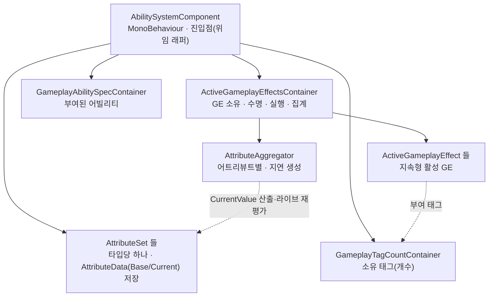
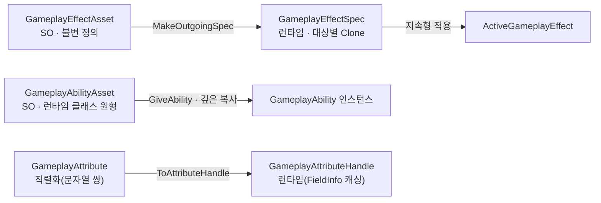
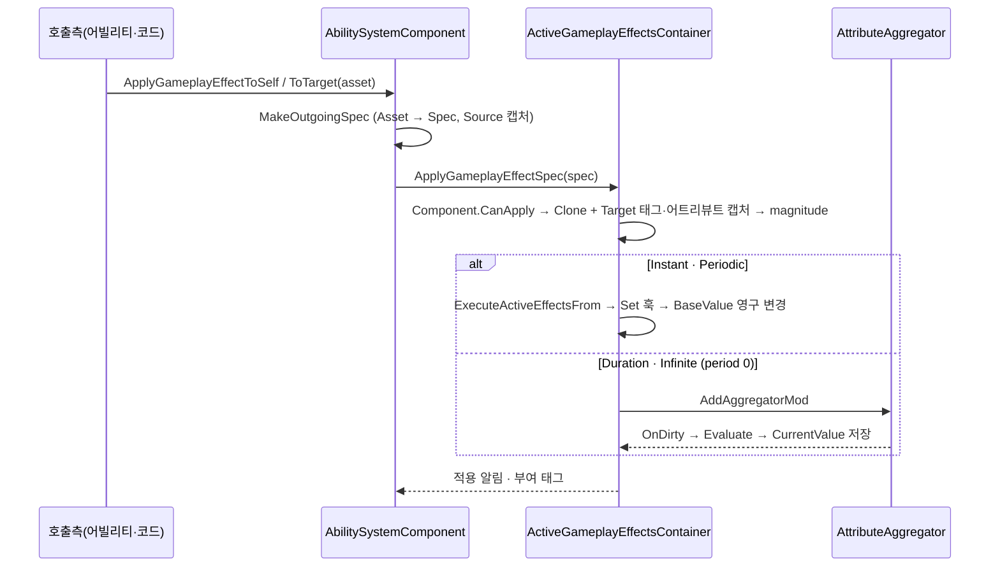

# AbilitySystem (GAS-like) — Overview

> **최종 갱신:** 2026-10-23 (KST)

`Assets/Scripts/Core/AbilitySystem/` — 캐릭터 수치·효과·태그·스킬을 다루는 Ability System. **UE5 GAS를 참고해 필요한 축만 골라 Unity에 직접 재구현**한 것이다 — 라이브러리 이식이 아니라 개념의 선택적 재구현. 채택/생략은 아래 [UE GAS 대비](#ue-gas-대비--채택생략) 참고.

> **심화 문서:** [Attribute](attribute.md) · [GameplayEffect](gameplay-effect.md) · [Aggregator (라이브 재평가)](aggregator.md) · [Capture (어트리뷰트 캡처)](capture.md) · [GameplayTag](gameplay-tag.md) · [GameplayAbility](gameplay-ability.md)
> 이 문서군은 **개념·방향** 중심이다. 필드·API 세부는 코드와 feature progress를 본다.
> 네이밍: 클래스명은 UE 용어를 따르되, SO(에셋 정의)에는 `Asset` 접미어로 런타임 타입과 구분한다.

## 핵심 구조

소유 관계 — `AbilitySystemComponent`는 진입점이고 실제 소유·수명·집계는 컨테이너가 맡는다.



정의 → 런타임 — 불변 SO 정의에서 런타임 인스턴스를 만든다.



- **ASC:** 수치·이펙트·태그·어빌리티의 진입점. 실제 소유·수명·집계는 컨테이너에 위임하는 얇은 래퍼.
- **계층:** 수치([attribute](attribute.md)) → 수치를 바꾸는 유일한 채널([gameplay-effect](gameplay-effect.md)) → 집계·반응성([aggregator](aggregator.md)) → 상태 표현([gameplay-tag](gameplay-tag.md)) → 실행 단위([gameplay-ability](gameplay-ability.md)).

## 적용 흐름

GE를 적용하면 정의(SO)가 대상별 Spec으로 복제되고, GE 타입에 따라 두 경로로 갈린다 — Instant/Periodic은 BaseValue를 **영구 변경**, Duration/Infinite(period 0)는 aggregator에 mod로 등록돼 **CurrentValue에만** 반영된다.



캡처 대상이 바뀌면 aggregator가 dirty를 전파해 의존 GE의 magnitude가 라이브 재평가된다 → [aggregator](aggregator.md). 어빌리티는 발동 조건을 확인한 뒤 코스트·쿨다운·효과를 모두 이 GE 경로로 건다 → [gameplay-ability](gameplay-ability.md).

## 사용 예 (End-to-End)

```csharp
// 소유 컴포넌트 — Set 등록과 초기 스탯
private void Awake()
{
    _asc.AddSpawnedAttribute(new CharacterAttributeSet());
}

private void Start()
{
    _asc.ApplyGameplayEffectToSelf(defaultAttributes); // Instant · Override 모디파이어

    // 어빌리티 부여 — 입력 ID로 발동
    _asc.GiveAbility(new GameplayAbilitySpec(attackAbility, inputID: 0));
}

// 입력
_asc.AbilityLocalInputPressed(0);

// GE 적용·조회·제거
ActiveGameplayEffectHandle handle = _asc.ApplyGameplayEffectToSelf(buffEffect);
float hp = _asc.GetAttributeCurrentValue(CharacterAttributeSet.Health);
bool stunned = _asc.HasMatchingGameplayTag(stunTag);
_asc.RemoveActiveGameplayEffect(handle);
```

## UE GAS 대비 — 채택/생략

> 범례: ✅ 구현·동작 · 🔜 계획(로드맵) · ❌ 미채택

| UE GAS | 이 프로젝트 | 상태 | 판단 |
|---|---|---|---|
| `UAbilitySystemComponent` | `AbilitySystemComponent` (+ 컨테이너) | ✅ | 수치·이펙트·태그·어빌리티 허브 |
| `UAttributeSet` / `FGameplayAttribute` | `AttributeSet` / `GameplayAttribute`·`GameplayAttributeHandle` | ✅ | `FieldInfo` 직렬화 불가라 직렬화용+런타임용 둘로 분리. 훅 6종 → [attribute](attribute.md) |
| `FGameplayEffectSpec` / `FActiveGameplayEffect` | `GameplayEffectSpec` / `ActiveGameplayEffect` | ✅ | 정의(SO)/런타임 분리 → [gameplay-effect](gameplay-effect.md) |
| `FGameplayModifierInfo` | `GameplayModifier` (연산 6종) | ✅ | → [gameplay-effect](gameplay-effect.md#modifier) |
| `FAggregator` (dirty/dependents) | `AttributeAggregator` | ✅ | 어트리뷰트별 집계 + 라이브 재평가(평가 채널은 하나) → [aggregator](aggregator.md) |
| `FGameplayEffectContext` | `GameplayEffectContext`(+Handle) | ✅ | 출처·피격 정보·대상별 복제 |
| `UGameplayEffectExecutionCalculation` | `GameplayEffectExecution` (+ Calculation Modifiers) | ✅ | 복합 계산 훅 → [gameplay-effect](gameplay-effect.md) |
| AttributeBased Magnitude / 캡처 | `AttributeBasedMagnitude` · `GameplayEffectAttributeCaptureSpec` | ✅ | snapshot/live → [capture](capture.md) |
| `UGameplayEffectComponent` | Asset Tags · Granted Tags · Target Tag Requirements · Remove Other | ✅ | 부가 Component(Chance to Apply 등)는 🔜 |
| GE Stack | 스택 수 1(합치기·시간 갱신) | ✅ | 스택 수 2 이상은 🔜 |
| `FGameplayEffectQuery` · 태그로 GE 찾기/제거 | `GameplayEffectQuery` + ASC 질의 API | ✅ | |
| `GameplayTags` 모듈 | `GameplayTag` · `GameplayTagContainer` · `GameplayTagQuery` · `GameplayTagsManager` + 에디터 | ✅ | → [gameplay-tag](gameplay-tag.md) |
| `FGameplayTagCountContainer` | `GameplayTagCountContainer` | ✅ | ASC 소유 태그·Loose 태그·태그 이벤트 |
| `UGameplayAbility` | `GameplayAbilityAsset` + `GameplayAbility` | ✅ | 생명주기·코스트/쿨다운·태그·입력 → [gameplay-ability](gameplay-ability.md) |
| `SetByCaller` / `ScalableFloat`(Curve) / Custom Calculation | (자리만) | 🔜 | Magnitude 확장 |
| `UAbilityTask` · GameplayEvent · AbilityTriggers | (없음) | 🔜 | |
| `GameplayCue` | (없음) | 🔜 | 연출 |
| Prediction / Replication (네트워크) | (미채택) | ❌ | 네트워크 레이어가 없어 레플리케이션 설계 자체가 성립하지 않음 (로컬 전용) |

## 디버그 도구

- **ASC 인스펙터·ASC 창**(에디터) — 런타임 어트리뷰트(Base/Current), 활성 GE(남은 시간·Modifier·Execution·캡처값), 부여된 어빌리티(활성 여부), 소유 태그. 창은 `Window ▸ Ability System ▸ ASC Inspector`.
- 읽기 전용 조회 API(`GetSpawnedAttributes`·`GetActiveGameplayEffects`·`GetActivatableAbilities`·`GetOwnedGameplayTags`)와 적용·제거 이벤트를 써서, 게임 화면 디버그 표시도 같은 정보를 그릴 수 있다.

---

- 프로젝트 아키텍처 인덱스: [../overview.md](../overview.md)
- feature 추적: [feature/ability-system](../../../agent/feature/feature-list.md)
